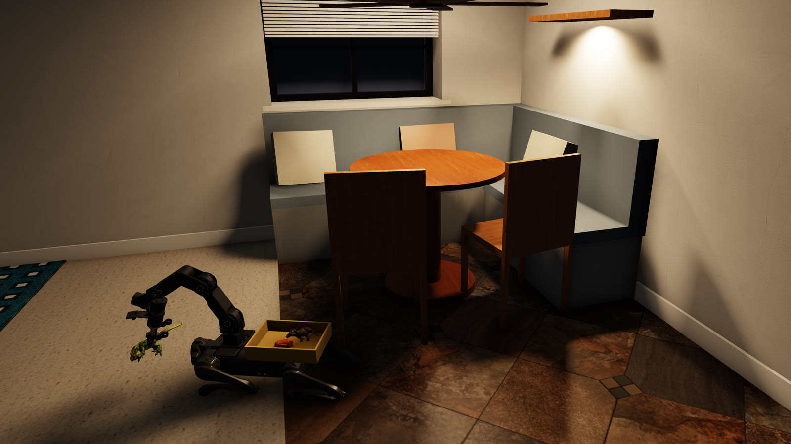

# Houndkeeper

**A robot dog that tidies the house at night.**

A staged shot in the simulator, rendered with Filament: what a night is meant to look like, not a recording of one.

While everyone sleeps, Barrymore walks the floor, works out what's new since last night, takes a closer look with a
camera on his wrist, and drops the sock, the Lego brick or the plastic dinosaur into a bin on his back. In the morning
the night's log is waiting on a phone, with anything he wasn't sure about set aside for a quick yes or no.

Barrymore is a Unitree Go2 with a MakerMods Maker Arm on his back, running on
[DimOS](https://github.com/dimensionalOS/dimos). Houndkeeper is a learning project, not a product: how far an open
robotics stack, one laptop GPU, a simulator that refuses to flatter, and AI coding agents held to a written spec can go.

## Why it's worth a look

- **It spots clutter by noticing change, not by knowing every object.** Each night is compared with the last, so a
  toy it has never seen is still new on the floor. In simulation it finds 43 of 48 new items (90%) at about 12 false
  alarms a night ([tTD] in the detection-baselines spec), and bins 43 of 62 items in front-zone pick trials (69%,
  [ZMc] in the sim-grasp spec).
- **The simulator is never kinder than the real world** ([x3f]). Printed parts flex, gearboxes have backlash, cameras
  lag, lenses distort, and the robot is never quite where it thinks it is: the sim models all of it. Its best finds were
  the places it flattered anyway: a clock running three times fast, so the camera saw a third of the frames it would
  on the robot, and camera frames that were never delayed at all ([docs/research](docs/research/README.md)).
- **Every claim traces to a requirement.** Built with the [Railyard Method](https://github.com/nickkoza/Railyard-Method):
  each requirement has an ID, each number states its conditions, every function links to what it implements, and a
  checker flags code that has drifted from its spec.
- **Private by design.** Camera data stays in the house ([zGo]). Models run locally; a hosted model is used only on
  purpose, and every use is logged ([eNx]).
- **One laptop.** A single 8 GB laptop GPU (an RTX 2070) runs the sims, the detectors and the training.

**Status: simulation only.** Every number above was measured in the sim; the real robot has not run a night yet. Each
number is stated with its conditions in the spec that owns it.

## How it's built

This repository follows the [Railyard Method](https://github.com/nickkoza/Railyard-Method): what the system must do is
written down before the code, and the code is traced back to it.

- **Specs** (`docs/specs/`) hold acceptance criteria, each with a three-character ID such as `[tTD]`, the decisions
  that pin how they're met, and a Tests table saying how each criterion is checked and whether it passes today.
- **Waymarks** (`docs/waymarks/`) record mechanisms that serve more than one spec; **principles**
  (`docs/principles/principles.md`) are the rules every spec answers to (for example [x3f]: the sim is never kinder
  than the real world).
- **The architecture model** (`docs/architecture/houndkeeper.json`) is a FINOS CALM document of the components and
  how they connect.
- **`symbols/`** is generated: one file per source file, linking each function and class to the criteria it
  implements. `node .claude/skills/spec-driven-change/tools/railyard.mjs check` reports code that changed since it
  was linked, criteria nothing implements, and code that implements nothing.
- **Research write-ups** (`docs/research/`) are the few investigations worth reading as stories: a sim that never
  delayed its camera frames, a benchmark replay kinder than the live robot, a detector whose misses were mostly its
  prompt.

## Layout

    src/houndkeeper/  the DimOS extension package: modules, skills and blueprints the robot runs (pip install -e .)
    sim/house/        the whole-house night: house and night generation, floor maps, change detection, scoring
    sim/arm/          MuJoCo arm sims (fast loops): grasp, tip, walk, reach, power, the wrist camera
    sim/dimos/        full nights on DimOS's own sim: the robot's real code against a simulated house
    sim/suite/        ./run <scenario>: named scenarios, pass gates, results history
    training/         learned-pick demos, dataset building and policy evaluation
    real/             bring-up, calibration procedures (they write params/) and real-night scoring
    arm_host/         the Raspberry Pi on the robot's back: its eyes now, the arm and wrist camera later
    cockpit/          phone pages for reviewing last night (DimOS Cockpit extensions)
    cad/              printed parts generated from code: the arm mount, bin and jaw pads, with their print checks
    models/           robot models (Go2, Maker Arm) and the item footprints; scanned items and textures are fetched
    params/robot.yaml every physical parameter, each tagged measured, vendor, sim or estimate
    tools/            asset fetch scripts, the Filament renderer build and its patches, export and import helpers
    tests/            pytest suite; tests name the criterion they check
    docs/             specs, waymarks, principles, architecture, research, backlog

## Setup

The repository expects a workspace folder holding it and its sibling checkouts:

    workspace/
      houndkeeper/        this repository
      dimos/              the DimOS fork, branch nick/feat/integration (github.com/nickkoza/dimos)

`HK_WORKSPACE` overrides the workspace (default: the folder holding this repository), and `HK_DIMOS` points at a
DimOS checkout elsewhere. Install DimOS and its virtual environment as its own README describes, then:

    ../dimos/.venv/bin/pip install -e .
    tools/fetch_items.sh          # scanned toys and household items (Google Scanned Objects)
    tools/fetch_floors.sh         # floor photos (ambientCG)
    tools/fetch_textures.sh       # wall, furniture and fabric textures (ambientCG)
    tools/build_mujofil.sh        # the Filament renderer for the robot's cameras (needs a Vulkan GPU)

Run the tests with `../dimos/.venv/bin/python -m pytest tests/`. A night on DimOS's sim is
`sim/dimos/night_tidy.sh` (see `sim/dimos/README.md`); sims run headless unless `HK_VIEWER=1`.

## Rules the project keeps

- The robot's camera data stays in the house ([zGo]). Hosted models are used only on purpose, and each use is logged
  ([eNx]).
- Every number is measured, vendor-published, or marked as an estimate ([sJQ]).
- The sim is never kinder than the real world ([x3f]), and the real house is the judge ([33f]).
- Nothing flashes in visible light ([0Py]).

## Licence

MIT (`LICENSE`). Third-party models, scans and textures keep their own licences; see `ATTRIBUTIONS.md`.
