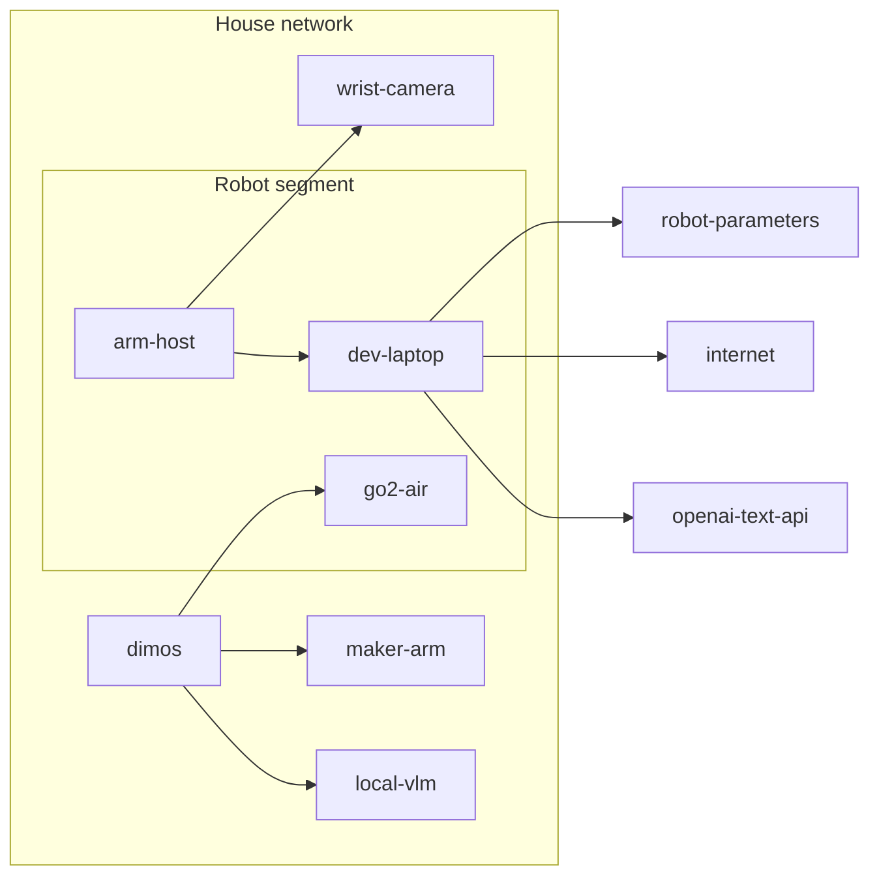

# Houndkeeper

**Type:** System spec · **Status:** Draft · **Source:** the grant proposal (private); principles [Dr5] · **ID:** [shn]

## Purpose

A Unitree Go2 carrying a Maker Arm keeps the floor of a real, lived-in house clear. At night, while the household
sleeps, it sweeps the floor, finds what is new since last time (socks, toys, food, paper), looks closer at each find,
picks up what it can into a bin on its back, and leaves the rest for a person to review in the morning. It runs on
DimOS, on hardware the project owns, with nothing seen in the house leaving it.

The yardstick for every part added: does it earn its place against a person tidying the floor by hand? (Adapted from
MOSS's "every added part has to earn its place against a person with a bag"; github.com/metrox-eth/moss,
docs/concept.md, CC BY 4.0.)

## Overview

For someone new to the project: what runs where, and how the parts talk. A component-and-connector view of the
architecture model's top level (`docs/architecture/houndkeeper.json`): DimOS (its modules, the tidy module among them)
and the development laptop (the sims, training and calibration tools deployed on it) are each one box, and the Maker
Arm includes its jaw pads. Arrows are the model's connections, from the side that drives. Only the development
laptop reaches outside the house, for a hosted text model (text only).

## Acceptance criteria

1. [jIh] **A night runs unattended.** Started by one command, the robot sweeps the ground floor, handles every find,
   and stops on its own, with no one touching it.
2. [Yke] **Every find is accounted for.** Each thing it flags is, by morning, either in the bin, judged to be nothing
   (a mark, a shadow, the floor itself), or on a review list with a picture and where it is. None is silently lost.
3. [39V] **Stains and permanent marks are not finds.** A mark that has been on the floor for several nights is not
   flagged again, and the robot never tries to pick up the floor.
4. [cIk] **Moved furniture is not clutter.** Chairs, stools and other furniture that move between nights are never
   flagged as items to pick up.
5. [ybm] **A morning report** lists what was picked up, what went to review and why, the area covered, and the battery
   used, readable without a terminal.
6. [lbv] **The robot stops for people and pets.** If a person or animal comes near while the arm is out, the arm stops
   and stows before anything else happens; while walking, it gives way and waits.
7. [Cts] **It never tips, never drops the arm on anything, never leaves the floor it was asked to cover.**
8. [LKR] **Nothing seen in the house leaves it** ([zGo]); all compute is local ([eNx]).
9. [J2u] **Wrong more often than right is visible.** If picks fail or finds are mostly false, the report says so in
   numbers, so a bad night is never mistaken for a good one.
10. [t8K] **Picking from tables and counters stays possible.** Nights only clear the floor for now, but nothing chosen
    for the hardware (arm mount, stow, bin, arm power) or the safety envelope rules out a later capability that uses
    the arm with the robot standing, such as picking something off a table ([28K]). Nor does the house map or the
    floor comparison assume the floor is the only surface, so a table can later become a surface of its own (see
    Later phases).

## Non-functional requirements

- One battery charge covers the ground floor (about 167 m2 of the sim layout; the real floor area is to be measured)
  with at least 20% charge left (estimate: model says 240-440 m2 per charge; see [qNo]).
- A night ends when the floor it was asked to cover is done or the battery reaches its reserve, whichever comes first;
  there is no fixed time limit. The report says which ended it.

- The robot's decisions (what to pick, where to stop, when to give up) live in code with no DimOS, simulator or
  hardware import, so they are tested without a robot; DimOS modules are thin wrappers around them. (After MOSS,
  whose teleop logic is kept apart from its dimOS and gamepad wrappers for the same reason; github.com/metrox-eth/moss,
  Apache-2.0.)

## Later phases (not in the first phase)

- **Tables as surfaces to keep tidy.** A table becomes a surface the robot scans and keeps tidy, like the floor. Unlike
  the floor, a table has things that belong on it, so the robot learns what is supposed to be there and flags only what
  isn't. Needs its own spec when it starts: upright scanning, a per-surface "belongs here" model, and standing picks
  within the tip envelope ([BPL]).

## Failure behavior

- If localisation is lost, the robot stops, stows the arm, and waits; it never guesses its way across the house.
- If the arm, its camera or the local VLM fails, the night continues without picking; every find goes to review.
- If the battery reaches the reserve, the robot stops where it is, stows, and says so in the report.

## Tests

| Criterion | Test | Status |
|---|---|---|
| [jIh] (a night runs unattended) | sim: `sim/dimos/tidy_run.sh` on DimOS; real: a supervised then unsupervised night | Partial: one command runs the loop unattended on DimOS's sim; picks rarely succeed yet (overnight log) |
| [Yke] (every find accounted for) | slice item accounting; real night review list | Partial: the DimOS tidy report gives every flag an outcome (binned, or review with a reason); no picture yet |
| [39V] (stains and marks not finds) | house-nights scenario: stains recognised as known | Partial: sim nights score it |
| [cIk] (moved furniture not clutter) | house-nights with moving chairs | Partial: big moves barely tested; results in [dws] Decisions |
| [ybm] (morning report) | report generated after each sim night | Not yet written |
| [lbv] (stops for people and pets) | sim: a person walks near during a pick; real: supervised test | Not yet written |
| [Cts] (never tips, never leaves the floor asked) | tip-safety scenario; slice tilt log | Partial |
| [LKR] (nothing leaves the house) | network audit of a real night; code review of every outbound call | Not yet written |
| [J2u] (bad nights visible) | report shows pick success and false-find rate | Not yet written |
| [t8K] (table and counter picking stays possible) | arm-mount upright-use results ([28K]); tip envelope covers standing | Not yet written |
